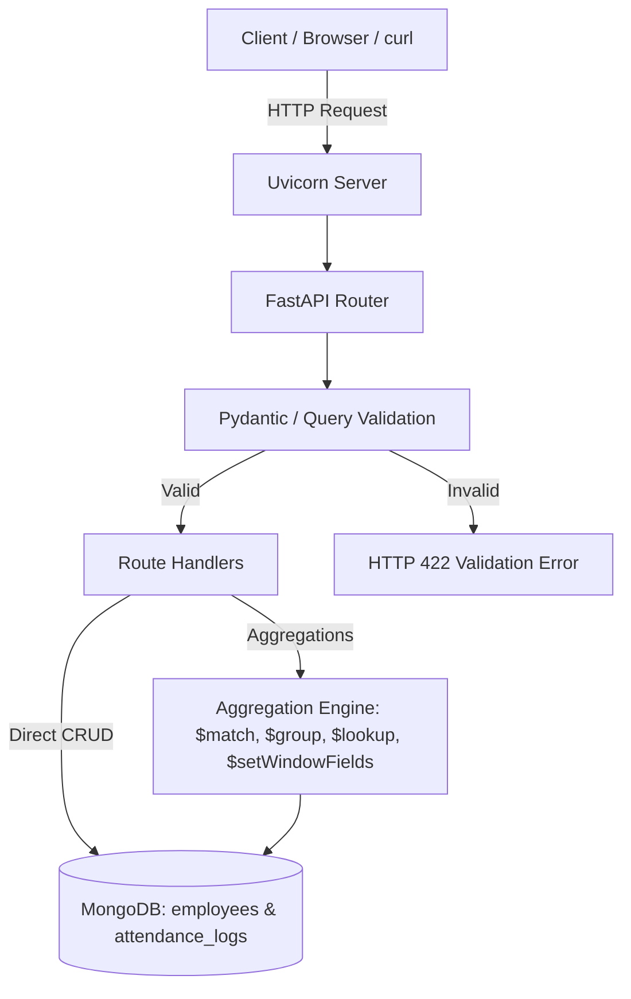

# Complete Guide: Employee Attendance & Analytics API
## Spring Boot Developer's Translation & Live Interview Prep

This document bridges your Spring Boot / Java background with this Python (FastAPI + MongoDB) codebase. It explains **what the project is**, **how each component works**, **how we solved every requirement**, and provides **practice interview quizzes** to help you ace your live walk-through.

---

## Table of Contents
1. [The Big Picture: What is this project?](#1-the-big-picture-what-is-this-project)
2. [Spring Boot to FastAPI & MongoDB: Rosetta Stone](#2-spring-boot-to-fastapi--mongodb-rosetta-stone)
3. [Architecture & Workflow Breakdown](#3-architecture--workflow-breakdown)
4. [The 5 Critical Architecture Decisions (DECISIONS.md)](#4-the-5-critical-architecture-decisions-decisionsmd)
5. [The Three "Hard" Analytics Pipelines](#5-the-three-hard-analytics-pipelines)
6. [How to Test the System Yourself (Browser Swagger UI)](#6-how-to-test-the-system-yourself-browser-swagger-ui)
7. [Live Interview Practice Quiz (With Answers & Explanations)](#7-live-interview-practice-quiz-with-answers--explanations)

---

## 1. The Big Picture: What is this project?

You have built a backend REST API for an enterprise employee attendance system:
- **Employees** punch in and punch out for daily shifts.
- **Managers** correct/regularize erroneous records (e.g. biometric scanner malfunctions) with a complete audit history.
- **Analytics** process attendance to calculate:
  - Monthly employee statistics (attendance percentage, work hours, overtime, leave).
  - Department summary (headcount, present days, average work hours).
  - Late leaderboard (ranking employees by minutes late with proper tie-handling).
  - Department trends (daily 7-day moving averages across every calendar day).

### The Three Parts of the Assignment:
- **Part A (Review & Fix)**: The original starter file had 20+ defects (race conditions, naive datetimes, broken pagination, banker's rounding). We fixed them and documented them in `REVIEW.md`.
- **Part B (Build)**: Implemented 7 missing endpoints (`punch-out`, `regularize`, 4 analytics endpoints, and `explain`).
- **Part C (Prove & Explain)**: Documented architectural choices in `DECISIONS.md` and proved that queries use index scans (`IXSCAN`).

---

## 2. Spring Boot to FastAPI & MongoDB: Rosetta Stone

If you understand Spring Boot, you already understand 95% of this architecture:

| Spring Boot Concept | Python / FastAPI Equivalent | What it does in this project |
|---|---|---|
| `pom.xml` / `build.gradle` | `requirements.txt` | Defines external libraries (`fastapi`, `uvicorn`, `pymongo`, `pydantic`). |
| Embedded Tomcat | **Uvicorn** (ASGI server) | The lightweight asynchronous HTTP server running the app. |
| `@SpringBootApplication` | `app = FastAPI(...)` in `app/main.py` | Initializes the FastAPI application instance. |
| `@RestController` + `@GetMapping("/path")` | `@app.get("/path")` / `@app.post(...)` | Defines the API routing endpoints. |
| Request DTOs + `@Valid` (`@NotNull`, `@Min`) | **Pydantic** (`BaseModel`, `Query(ge=1, le=50)`) | Automatically deserializes JSON and validates query/body fields, returning HTTP `422` on errors. |
| `MongoTemplate` / Spring Data Mongo | **PyMongo** (`db.attendance_logs.aggregate(...)`) | The official driver connecting directly to MongoDB. |
| `DuplicateKeyException` | `pymongo.errors.DuplicateKeyError` | Exception thrown when a unique index is violated. Catching this allows returning HTTP `409 Conflict`. |
| `springdoc-openapi` (`/swagger-ui/index.html`) | **`http://localhost:8000/docs`** | FastAPI automatically generates an interactive Swagger UI. |
| `BigDecimal` (`RoundingMode.HALF_UP`) | `decimal.Decimal` (`ROUND_HALF_UP`) | Standard commercial half-up rounding (Python's native `round()` uses banker's rounding). |

---

## 3. Architecture & Workflow Breakdown

All application code lives in a single file: `app/main.py`.



### The Database Collections:
1. **`employees`**:
   - Primary identifier: `emp_code` (e.g. `EMP0001`). `_id` is MongoDB internal and never exposed.
   - Fields: `name`, `email`, `department`, `joined_on`, `shift_start`, `shift_end`.
2. **`attendance_logs`**:
   - Primary key: Compound natural key `(emp_code, date)`.
   - Fields: `status`, `punch_in`, `punch_out`, `work_hours`, `late_minutes`, `overtime_minutes`, `half_day`, `history`.

---

## 4. The 5 Critical Architecture Decisions (DECISIONS.md)

These are the 5 questions you must be prepared to answer in your technical interview:

### 1. Indexes Created
- **`employees.emp_code` (Unique)**: Enforces one employee per code at the database level.
- **`attendance_logs(emp_code, date)` (Unique, Compound)**: Enforces one attendance record per employee per day. Makes every natural-key lookup an index scan (`IXSCAN`).
- **`attendance_logs(date, emp_code)` (Compound)**: Optimizes date-range queries, sorting by date descending + employee ascending, and trend aggregations.
- *Why we rejected an index on `status`*: Status has only 5 values (very low cardinality). A B-tree index on low-cardinality fields is ignored by the MongoDB query optimizer in favor of the compound date index.

### 2. Punch-in Concurrency (Race Conditions)
- **The Problem**: What happens if two identical punch-in requests hit the server at the exact same millisecond?
- **The Solution**: Avoid "check-then-insert" (`find_one` then `insert_one`), which has a race window. Instead, attempt `insert_one()` directly.
- MongoDB's unique index on `(emp_code, date)` serializes the write:
  - First request succeeds: returns **`201 Created`**.
  - Second request throws `DuplicateKeyError`: our code catches it and returns **`409 Conflict`**.

### 3. Ties at the Leaderboard Cutoff
- **The Problem**: What happens if two employees tie for late minutes at the cutoff limit (e.g. limit=10)?
- **The Solution**: We use MongoDB's `$setWindowFields` with `$rank` (standard competition ranking: 1, 2, 2, 4).
- The subsequent filter is `{"$match": {"rank": {"$lte": limit}}}`. Both tied employees share rank 10 and are returned. The response may contain more than `limit` rows, ordered by `emp_code` ascending.

### 4. Zero-Log Headcount in Department Summary
- **The Problem**: If an employee was on approved leave or absent all month, they have zero punch logs. How do we count them in headcount?
- **The Solution**: The aggregation starts from the `employees` collection (the parent table), filtering by `joined_on <= end_of_month`.
- It performs a `$lookup` (the MongoDB equivalent of a SQL `LEFT OUTER JOIN`) to `attendance_logs`. Employees with zero records produce an empty array `[]`, but are still counted in department headcount.

### 5. Scaling to 100x Data (10 Million Records)
- **The Problem**: Running heavy aggregation pipelines across 10 million attendance records on every HTTP request will overwhelm the database.
- **The Solution**: Introduce a **pre-aggregated daily snapshot collection** (`daily_department_stats`) updated at write time (punch-out and regularization). Analytics endpoints will query this compact table via fast index lookups instead of scanning millions of raw logs.

---

## 5. The Three "Hard" Analytics Pipelines

### 1. Late Leaderboard (`GET /analytics/leaderboard/late`)
- Finds all logs for the month where `late_minutes > 0`.
- Groups by `emp_code`, summing late minutes and counting late instances.
- Joins employee names and departments using `$lookup`.
- Computes standard competition ranking using `$setWindowFields` (`$rank`).
- Filters `rank <= limit`.

### 2. Department Summary (`GET /analytics/departments/summary`)
- Starts from `employees` where `joined_on <= last_day_of_month`.
- Joins `attendance_logs` for that month.
- Aggregates headcount, working days presence (half-day = 0.5), average work hours, late instances, and leave count.

### 3. Department Trend (`GET /analytics/departments/{dept}/trend`)
- Guarantees **exactly one row for every calendar day** in the requested date range, including weekends and days with 0 attendance logs.
- Calculates attendance rate for working days (`present_count / headcount`).
- Computes a 7-day moving average using up to 6 preceding days within the requested range.

---

## 6. How to Test the System Yourself (Browser Swagger UI)

You don't need `curl` or terminal scripts to test! FastAPI provides an interactive GUI:

1. Make sure your server is running:
   ```powershell
   .venv\Scripts\python -m uvicorn app.main:app --port 8000
   ```
2. Open your web browser and navigate to:
   **`http://127.0.0.1:8000/docs`**

3. Try out these key endpoints:
   - **Check Health**: Expand `GET /health` ➡️ Click **Try it out** ➡️ Click **Execute** (Returns `200 OK`, `{"status": "ok"}`).
   - **Late Leaderboard**: Expand `GET /analytics/leaderboard/late` ➡️ Enter `month`: `2026-07` ➡️ Click **Execute** (Returns Neha Iyer, Rank 1).
   - **Department Summary**: Expand `GET /analytics/departments/summary` ➡️ Enter `month`: `2026-07` ➡️ Click **Execute** (Returns department breakdown with headcount).
   - **Department Trend**: Expand `GET /analytics/departments/{department}/trend` ➡️ Enter `department`: `Sales`, `from`: `2026-07-01`, `to`: `2026-07-10` ➡️ Click **Execute** (Returns all 10 calendar days with moving averages).
   - **Explain Plan**: Expand `GET /admin/explain/{endpoint}` ➡️ Enter `endpoint`: `late_leaderboard`, `month`: `2026-07` ➡️ Click **Execute** (Shows the raw MongoDB explain output with `IXSCAN`).

---

## 7. Live Interview Practice Quiz (With Answers & Explanations)

Review these multiple-choice questions to test your knowledge for the interview.

---

### Quiz Question 1: Concurrency Control
**Q: How does the application prevent duplicate records when two identical punch-in requests arrive at the same time?**
- A) A Python threading lock `threading.Lock()` synchronizes requests in memory.
- B) A `find_one()` query checks if a record exists before calling `insert_one()`.
- C) *(Correct)* A unique compound index on `(emp_code, date)` causes MongoDB to serialize the inserts. One succeeds (201), the other raises `DuplicateKeyError` which is caught and returned as 409 Conflict.
- D) A MongoDB transaction acquires a distributed row lock.

**Explanation**: In distributed and concurrent web servers (like Uvicorn running multiple workers), in-memory locks fail. Check-then-insert has a race condition window. The only race-safe design is relying on database-level unique constraints.

---

### Quiz Question 2: Ranking and Ties
**Q: If two employees are tied with 45 minutes of late time for Rank 2, what should the next employee's rank be according to standard competition ranking?**
- A) Rank 3
- B) *(Correct)* Rank 4
- C) Rank 2.5
- D) Array index + 1

**Explanation**: Standard competition ranking (1, 2, 2, 4) skips the subsequent rank for each tie. In MongoDB, this is achieved with `$setWindowFields` using the `$rank` function (unlike `$denseRank` which would produce 1, 2, 2, 3).

---

### Quiz Question 3: Rounding Precision
**Q: Why couldn't we use Python's built-in `round(value, 2)` for computing work hours?**
- A) Python's `round()` only accepts integers.
- B) Python's `round()` truncates numbers instead of rounding.
- C) *(Correct)* Python's `round()` uses banker's rounding (round-to-even), where `8.125` rounds to `8.12`. The business rules explicitly require round half-up (`8.13`).
- D) `round()` raises a TypeError on floating point values.

**Explanation**: Banker's rounding rounds ties to the nearest even number. Business requirements (R4 & R8) require commercial rounding (half-up). We use Python's `decimal.Decimal` with `ROUND_HALF_UP` (just like Java's `BigDecimal.setScale(2, RoundingMode.HALF_UP)`).

---

### Quiz Question 4: Zero-Log Headcount
**Q: In the department summary endpoint, why do we start the aggregation from the `employees` collection rather than `attendance_logs`?**
- A) It is faster to query `employees` than `attendance_logs`.
- B) `attendance_logs` does not store the employee's name.
- C) *(Correct)* If an employee has zero logs in the month (e.g. full-month leave or mid-month joiner), starting from logs would completely omit them from the department headcount.
- D) MongoDB prohibits using `$lookup` on `attendance_logs`.

**Explanation**: Starting from `employees` acts as a `LEFT OUTER JOIN`. Every valid employee contributes to the `headcount`, even if their joined attendance logs array is empty (`[]`).

---

### Quiz Question 5: Audit History Immutability
**Q: When a manager regularizes an attendance record via `PATCH /attendance/{emp_code}/{date}`, what happens to the existing history?**
- A) The old history is overwritten with the new record.
- B) The history is stored in a separate SQL audit table.
- C) *(Correct)* A new history entry is appended to the existing `history` array. Old entries are never modified or deleted.
- D) The record is cloned and marked as superseded.

**Explanation**: The history field is an append-only audit trail capturing `at`, `by`, `reason`, and a `changes` object containing `from` and `to` values for modified fields.
